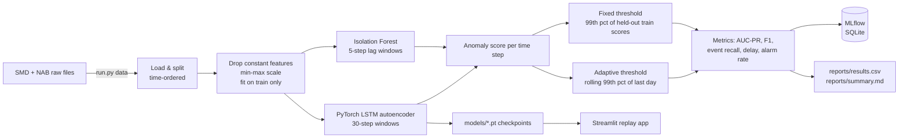

# Real-Time Anomaly Detection for Cloud Server Metrics

**A PyTorch LSTM autoencoder that spots anomalies in multivariate server metrics, benchmarked
against an Isolation Forest baseline on labeled data, with a Streamlit app that replays a metric
stream and raises alerts as it goes.**

> **Live demo:** _coming soon (Streamlit Community Cloud)_ · Run it locally: `python run.py app`

## Results at a glance

On the Server Machine Dataset (3 machines, 38 metrics each, mean across machines):

| | Isolation Forest (baseline) | **LSTM autoencoder** |
|---|---|---|
| **AUC-PR** (threshold-free ranking quality) | 0.235 | **0.376** (+60%) |
| **Mean detection delay** (steps from anomaly onset to first alert)* | 117.2 | **2.2** |
| Anomaly events caught (fixed threshold) | 74.7% | **100%** |
| Best achievable F1 (oracle threshold, upper bound only) | 0.274 | **0.437** |

\*The delay is measured with the fixed threshold, which over-alarms on 2 of 3 machines (see
[Limitations](#limitations)). On the one machine where that threshold behaves normally (about 2%
alarm rate), the comparison still holds: **4.2 vs. 7.3 steps, with 100% vs. 62% of events caught.**

## Why this matters

Cloud teams watch thousands of metrics, including CPU, network I/O, disk, and request counts. Static
alert rules either miss slow-building problems or page engineers for noise. A learned detector models
what "normal" looks like across many metrics *jointly* and flags departures from it, which is the idea
behind AIOps tools like Amazon CloudWatch Anomaly Detection.

This project asks a practical question: **does a deep sequence model actually beat a strong classical
baseline on labeled server data, and what does it take to turn its scores into usable alerts?**

## Data

| Dataset | What it is | Used here | License |
|---|---|---|---|
| [Server Machine Dataset (SMD)](https://github.com/NetManAIOps/OmniAnomaly) | 5 weeks of 1-minute metrics from servers at a large internet company, with point-level anomaly labels | 3 machines (`machine-1-1`, `2-1`, `3-1`), one per machine group. About 28k train + 28k test steps each, 38 metrics | MIT |
| [Numenta Anomaly Benchmark (NAB)](https://github.com/numenta/NAB) | Labeled real-world streams | All 17 `realAWSCloudwatch` series (EC2 CPU, network, disk; RDS CPU; ELB requests), 5-minute steps | MIT |

`python run.py data` downloads only the needed files (about 57 MB) over HTTPS into `data/`, which is
gitignored. No data is committed. One NAB series has no labeled anomalies in its test portion and is
excluded from averages, but it's kept in `reports/results.csv`.

## Approach



- **Splits:** SMD has a separate unlabeled train file (assumed mostly normal) and a labeled test
  file. For NAB, the first 15% of each series is used for training (NAB's "probationary period").
  The **last 20% of training data is held out** for picking thresholds. Test labels are never used
  for training or thresholds.
- **Baseline: Isolation Forest** on flattened 5-step windows (200 trees).
- **Model: LSTM autoencoder.** An encoder LSTM compresses a 30-step window into a 64-dim state, and a
  decoder LSTM reconstructs the window. The anomaly score at time *t* is the reconstruction error of
  the window's **last** step, so it only uses data up to *t*, as a live detector would. It's trained
  for 10 epochs on CPU, about 1 minute per machine.
- **Two label-free thresholds, reported side by side:**
  - *Fixed:* the 99th percentile of scores on the held-out training slice.
  - *Adaptive:* the rolling 99th percentile of the previous day of scores (causal, seeded with the
    held-out scores).
- **Metrics:**
  - AUC-PR (threshold-free).
  - Point-wise precision, recall, and F1.
  - **Event recall**: the share of anomaly segments with at least one alert.
  - **Detection delay**.
  - **Alarm rate**.
  - I deliberately **don't** report the "point-adjusted" F1 common in papers, because it inflates
    scores even for random detectors. The oracle best-F1 is shown only as an upper bound.
- **Reproducible:** seeded NumPy/PyTorch, pinned `requirements.txt`, every run logged to MLflow.

## Full results

Means over series with labeled anomalies (`reports/summary.md`; per-series rows in `reports/results.csv`):

| dataset | model | threshold | AUC-PR | oracle F1 | precision | recall | F1 | alarm rate | event recall | delay (steps) |
|---|---|---|---|---|---|---|---|---|---|---|
| SMD (3) | Isolation Forest | fixed | 0.235 | 0.274 | 0.247 | 0.376 | 0.220 | 22.3% | 74.7% | 117.2 |
| SMD (3) | **LSTM AE** | fixed | **0.376** | **0.437** | 0.226 | 0.581 | 0.218 | 24.0% | **100%** | **2.2** |
| SMD (3) | Isolation Forest | adaptive | 0.235 | 0.274 | 0.170 | 0.078 | 0.097 | 2.0% | 55.4% | 165.4 |
| SMD (3) | **LSTM AE** | adaptive | **0.376** | **0.437** | 0.243 | 0.136 | **0.145** | 1.7% | **91.7%** | **40.4** |
| NAB AWS (16) | Isolation Forest | fixed | 0.186 | 0.282 | 0.281 | 0.327 | 0.183 | 27.8% | 97.9% | 62.8 |
| NAB AWS (16) | LSTM AE | fixed | 0.211 | 0.296 | 0.284 | 0.275 | 0.189 | 19.6% | 97.9% | 50.8 |
| NAB AWS (16) | Isolation Forest | adaptive | 0.186 | 0.282 | 0.269 | 0.202 | 0.173 | 11.5% | 88.5% | 56.9 |
| NAB AWS (16) | LSTM AE | adaptive | 0.211 | 0.296 | 0.233 | 0.077 | 0.092 | 4.6% | 100% | 41.5 |

## Key insights

1. **The LSTM autoencoder ranks anomalies much better on multivariate data.** AUC-PR is +60% on
   SMD, and the gain held on all 3 machines (0.49 vs. 0.37, 0.25 vs. 0.24, 0.38 vs. 0.09). Modeling
   how 38 metrics move *together* over time is where the sequence model earns its keep.
2. **On single-metric AWS streams the gap nearly disappears** (AUC-PR 0.211 vs. 0.186). With one
   metric and only about 2 days of training data, a simple model is hard to beat. That's a useful
   result: the deep model is worth it for wide, correlated telemetry, not for every alarm.
3. **Thresholding, not modeling, is the bottleneck.** The oracle F1 (0.437) is double the F1 from
   either label-free threshold. The ranking is good, but turning scores into alerts under drift is
   the hard part.
4. **The adaptive threshold trades recall for a quiet pager.** It cut the SMD alarm rate from 24%
   to 1.7% (14× fewer alerts) and fixed the worst drifting machine (`machine-3-1` F1 0.054 → 0.216).
   But it lowers average F1, because a rolling 99th percentile absorbs a *sustained* anomaly after
   about 1% of its window. It flags the onset, then goes quiet. Even so, under the adaptive
   threshold the LSTM still caught 92% of events vs. 55% for the baseline, about 4× faster.

## Limitations

- **Distribution drift breaks the fixed threshold.** On `machine-1-1` and `machine-3-1`, the test
  weeks behave differently from the training weeks, so a threshold calibrated on held-out training
  data fires on 13–51% of test points, depending on the machine and model. The 100% event recall and 2-step delay under the fixed
  threshold partly reflect that high alarm rate. The adaptive threshold controls the alarm rate
  but under-detects long anomalies. Neither is production-ready on its own.
- **Small benchmark:** 3 SMD machines (out of 28) and 17 short NAB series. The results show
  direction, not statistical significance.
- **Light tuning by design:** one architecture, default hyperparameters, no search. A larger
  window, attention, or a forecasting-based model may do better.
- **NAB training data is short** (15% of each series, about 2 days), which limits both models.
- **The "real-time" demo is a replay** of a recorded stream, not a live CloudWatch connection.

## Next steps

- A hybrid alert rule: adaptive threshold for the onset, plus a "stay in alarm while the score is
  above the fixed level" hold to keep long anomalies flagged.
- Per-metric reconstruction error, to show *which* metrics caused an alert (SMD ships
  interpretation labels to evaluate this).
- Evaluate on all 28 SMD machines and add a forecasting-based baseline.
- Stream real CloudWatch metrics through the same scorer (e.g. Lambda + EventBridge).

## How to run

Requires Python 3.12. Every step is one command:

```bash
python -m venv .venv
```
```bash
.venv/Scripts/python -m pip install -r requirements.txt    # macOS/Linux: .venv/bin/python
```
```bash
.venv/Scripts/python run.py all     # download data (~57 MB) + train + evaluate (~6 min on CPU)
```
```bash
.venv/Scripts/python run.py test    # ruff + pytest (27 tests)
```
```bash
.venv/Scripts/python run.py app     # Streamlit demo at http://localhost:8501
```

`make data | train | test | app | all` does the same on macOS/Linux. To browse experiment runs,
run `mlflow ui --backend-store-uri sqlite:///mlflow.db`.

## Project structure

```
src/anomaly/
  config.py      paths, dataset lists, hyperparameters
  download.py    fetch only the needed raw files over HTTPS
  data.py        loading, train-only scaling, time-ordered splits, sliding windows
  models.py      Isolation Forest + PyTorch LSTM autoencoder (same fit/score interface)
  metrics.py     point P/R/F1, event recall, detection delay, AUC-PR, oracle F1
  pipeline.py    train/evaluate loop, fixed + adaptive thresholds, MLflow logging, reports
app/streamlit_app.py   stream replay with alert markers and threshold toggle
tests/                 unit tests for windowing, leakage, metrics, models, thresholds
models/                trained LSTM checkpoints (+ scaler, threshold) used by the app
reports/               results.csv, summary.md, configs.json
```

## Tech stack

Python 3.12 · PyTorch · scikit-learn · pandas · NumPy · MLflow · Streamlit · Plotly · pytest ·
ruff · GitHub Actions

## Acknowledgements

SMD from Su et al., *Robust Anomaly Detection for Multivariate Time Series through Stochastic
Recurrent Neural Network* (KDD 2019), via the OmniAnomaly repository (MIT). NAB from Lavin & Ahmad,
*Evaluating Real-time Anomaly Detection Algorithms: the Numenta Anomaly Benchmark* (2015) (MIT).

## License

MIT
